# Exercise 10 – Multi-Node Kubernetes Cluster with Multiple Applications and ReplicaSets

## Objective
Set up a 3-node Kubernetes cluster using Minikube and deploy two distinct Flask microservices (Product Catalog and Shopping Cart) with ReplicaSets. Use pod anti-affinity rules to distribute replicas across multiple worker nodes to achieve high availability and fault tolerance.

## What I did
- Stopped and removed previous Minikube instances and started a fresh 3-node cluster named `devops-multinode`.
- Enabled Minikube's built-in registry add-on to share container images across all worker nodes.
- Created two Flask applications in Python: `product_catalog.py` (AppA) and `shopping_cart.py` (AppB).
- Wrote Dockerfiles for both services (`Dockerfile.product` and `Dockerfile.shopping`), built both images locally, and loaded them into the Minikube cluster using `minikube image load`.
- Wrote Kubernetes Deployment manifests with pod anti-affinity (`kubernetes.io/hostname`) to spread 2 replicas of Product Catalog and 3 replicas of Shopping Cart across different nodes.
- Wrote and applied NodePort Service manifests to expose both applications.
- Verified pod status and node distribution with `kubectl get pods -o wide`.
- Accessed both services via Minikube service tunnels and tested endpoints (`/products`, `/cart`) with browser visits and `curl.exe` GET/POST commands.

## Key Concepts
- **Multi-Node Cluster** – Running multiple worker nodes so that if one node fails, replicas running on other nodes continue serving traffic without downtime.
- **Pod Anti-Affinity** – A scheduling rule (`podAntiAffinity`) configured with `topologyKey: "kubernetes.io/hostname"` that prevents the Kubernetes scheduler from placing replicas of the same service on the same node.
- **Minikube Registry Add-on** – Enables a local Docker registry inside Minikube so multi-node setups can share and pull locally built container images across nodes.
- **NodePort Services** – Exposes Kubernetes pods externally by opening a static port on every node in the cluster.

## Output

### Part 1: Cluster Setup & Registry Add-on
Starting a 3-node Minikube cluster:
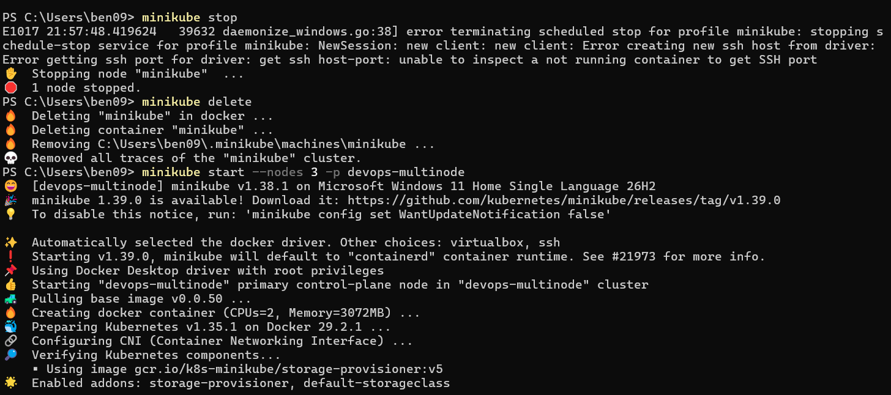

Enabling the registry add-on:
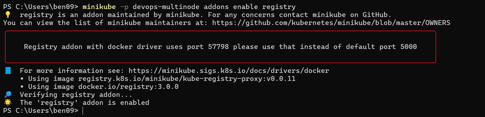

### Part 2: Building and Loading Docker Images
Building Product Catalog image:
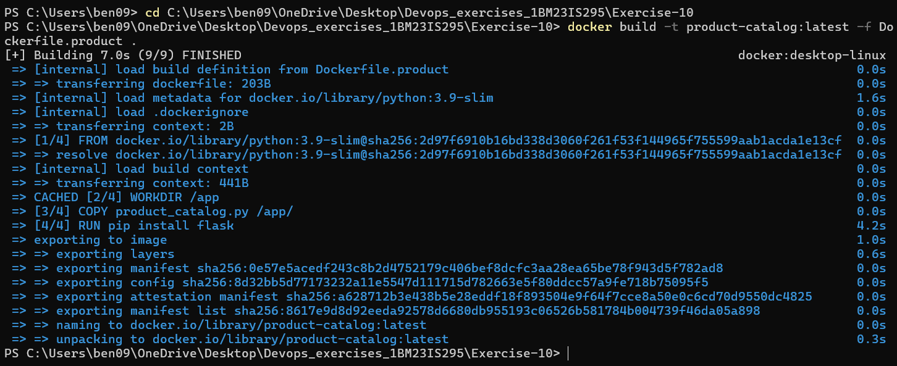

Building Shopping Cart image:
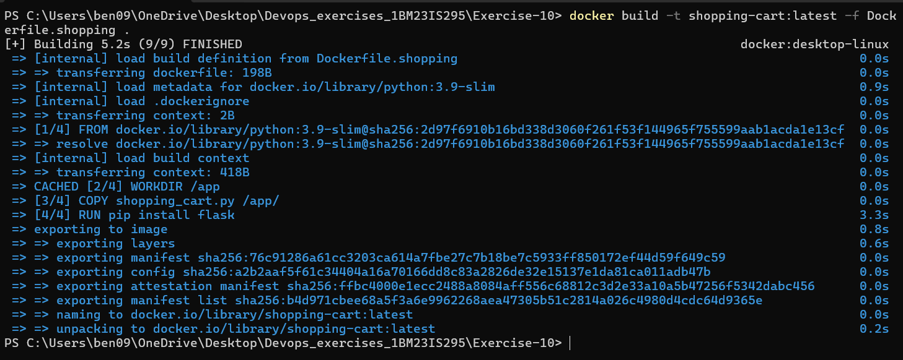

Listing local Docker images:
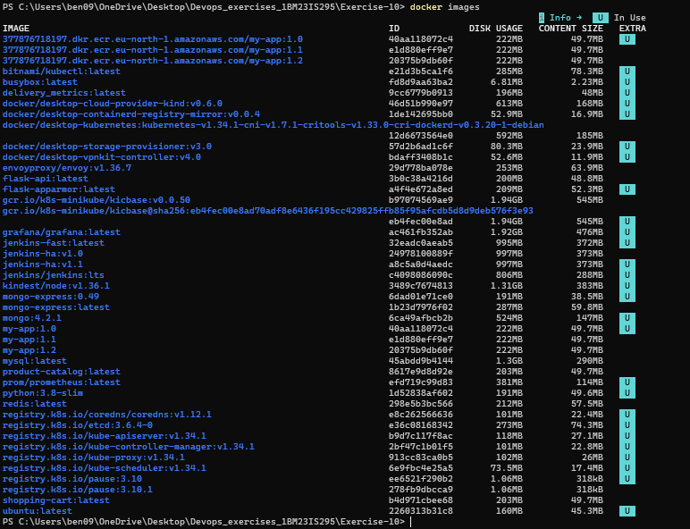

Loading images into Minikube and verifying inside the cluster:
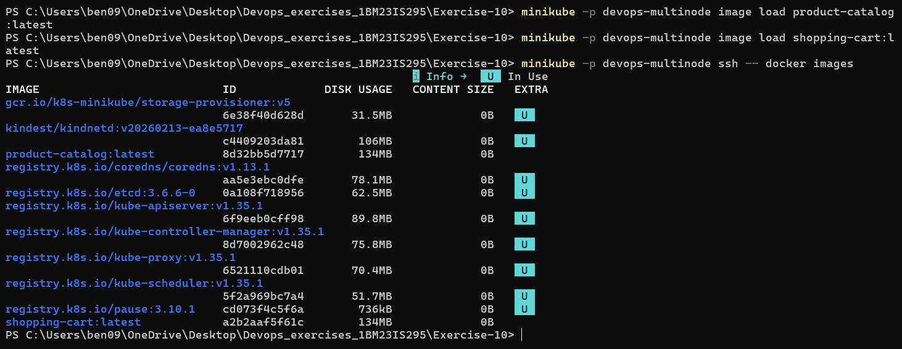

### Part 3: Deploying Applications and Pod Distribution
Applying deployment and service manifests:
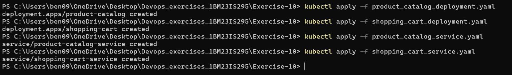

Verifying pod distribution across all 3 nodes (`devops-multinode`, `devops-multinode-m02`, `devops-multinode-m03`):
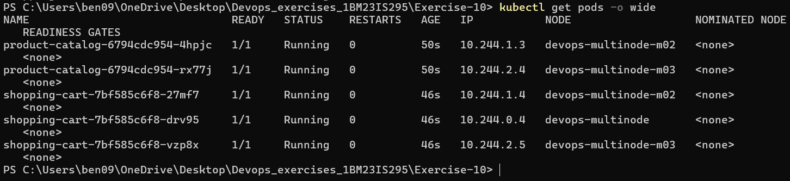

### Part 4: Testing Product Catalog Service
Starting the tunnel for Product Catalog service:
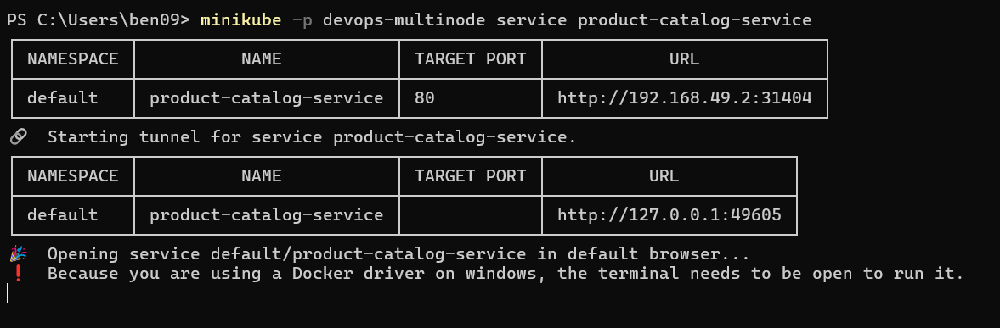

Initial root check returning 404 (as `/` is unmapped):
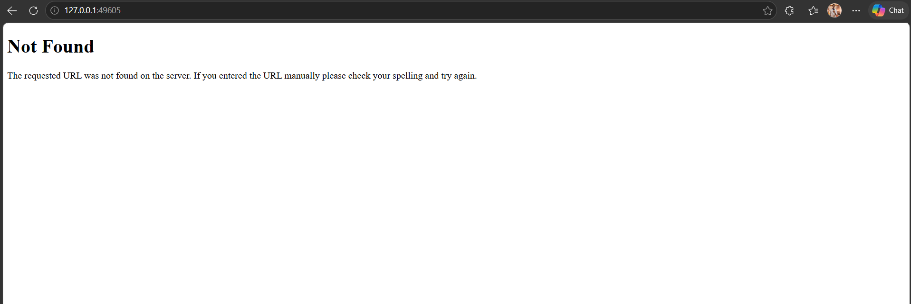

Accessing `/products` in browser:
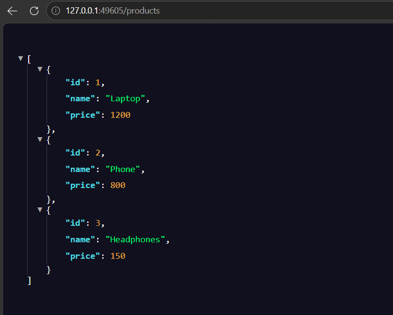

Testing `/products` endpoint using `curl.exe`:
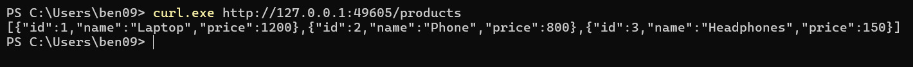

### Part 5: Testing Shopping Cart Service
Starting the tunnel for Shopping Cart service:
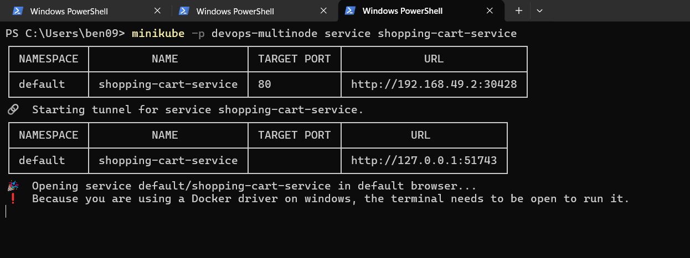

Initial root check returning 404 (as `/` is unmapped):
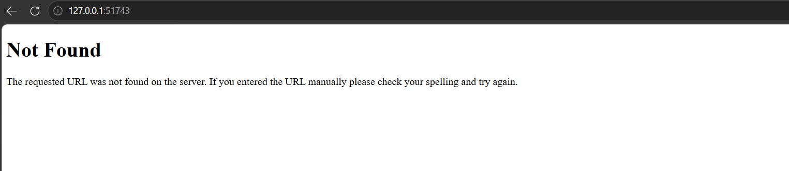

Initial empty cart (`[]`) in browser:
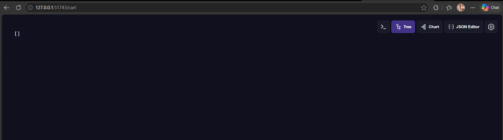

Verifying initial empty cart with `curl.exe`:
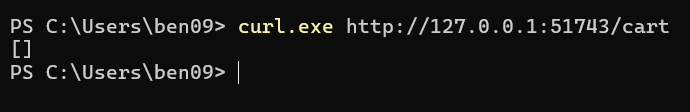

Sending POST request to add an item to the cart:
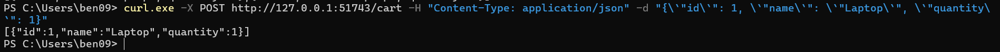

Refreshing browser to see item added in cart:
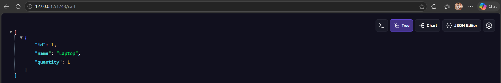
