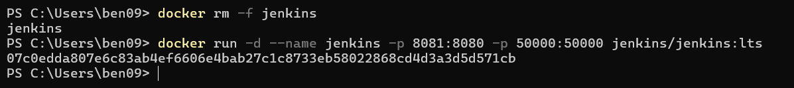
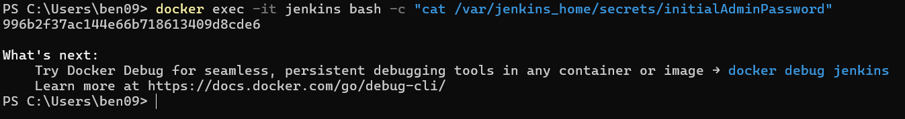
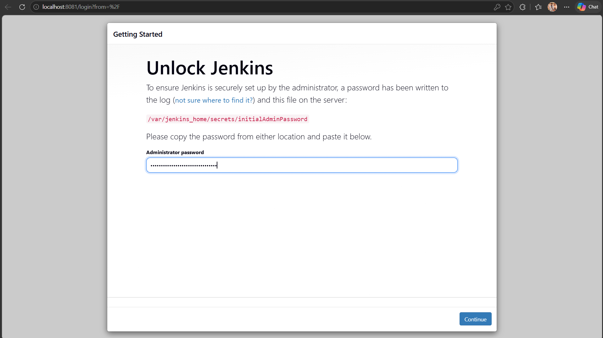
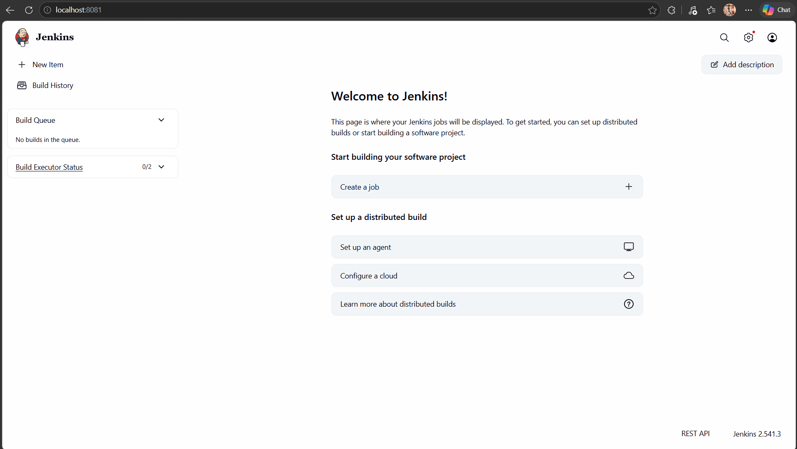

# Exercise 7 – Introduction to CI and Jenkins Installation

## Objective
Understand the core concepts of Continuous Integration (CI) and perform a fresh local installation of Jenkins using Docker.

## What I did
- Learned the fundamentals of Continuous Integration (CI), its benefits, and popular CI tools (GitLab, CircleCI, Travis CI, Jenkins, etc.)
- Installed Jenkins locally using a Docker container (Mapped to port 8081 to avoid conflicts with an existing container)
- Extracted the initial administrator password from the container to unlock Jenkins
- Completed the initial Jenkins setup via the web interface

## Key Concepts
- **Continuous Integration (CI)** – A practice where developers frequently merge code to a shared repository, triggering automated builds and tests to detect errors early.
- **Jenkins** – An open-source automation server used to build, test, and deploy software.
- **Jenkins Pipeline** – A series of automated steps to build, test, and deploy applications.
- **Plugins** – Extensions that add functionality to Jenkins (e.g., Git plugin, Docker plugin).
- **Nodes/Agents** – Machines where Jenkins executes jobs.

## Output

Starting Jenkins using Docker on Port 8081 (since 8080 was in use):

Extracting the Initial Admin Password from the container:

Accessing Jenkins and unlocking it using the retrieved password:

Jenkins Landing Page after successful setup:

