# Exercise 8 – Creating a "Hello World" Jenkins Job

## Objective
Create a separate GitHub repository with a bash script and configure a Jenkins Freestyle Job to pull the code from GitHub and execute it automatically.

## What I did
- Created a new GitHub repository named `devops-sample-code`.
- Wrote a simple `hello-world.sh` bash script locally.
- Initialized a local Git repository, committed the script, and pushed it to the `main` branch of the new GitHub repository.
- Started the local Jenkins Docker container and accessed the Jenkins dashboard.
- Created a new Jenkins **Freestyle project** named `HelloWorld`.
- Configured Jenkins **Source Code Management (SCM)** to automatically clone the GitHub repository.
- Added an **Execute shell** build step to run `sh hello-world.sh`.
- Triggered the Jenkins job manually and reviewed the successful console output.

## Key Concepts
- **Jenkins Freestyle Job** – A classic, highly customizable Jenkins job type that allows setting up simple continuous integration workflows through a web UI.
- **Source Code Management (SCM)** – Linking a Git repository directly to a Jenkins job so Jenkins can automatically fetch the latest source code into its workspace before building.
- **Execute Shell Build Step** – A build step that runs scripts and commands exactly as if they were typed into a Linux terminal inside the Jenkins workspace.

## Output

### Part 1: GitHub Repository Setup
Creating the new GitHub repository:
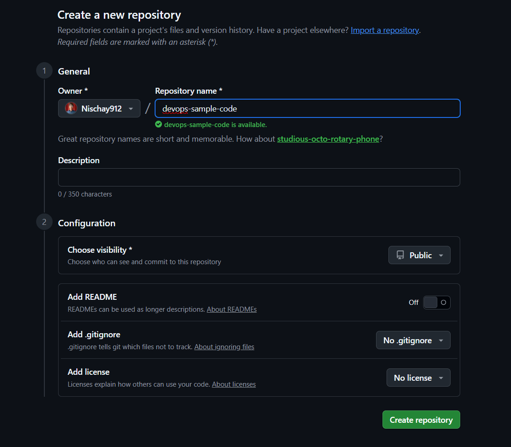

Repository created:
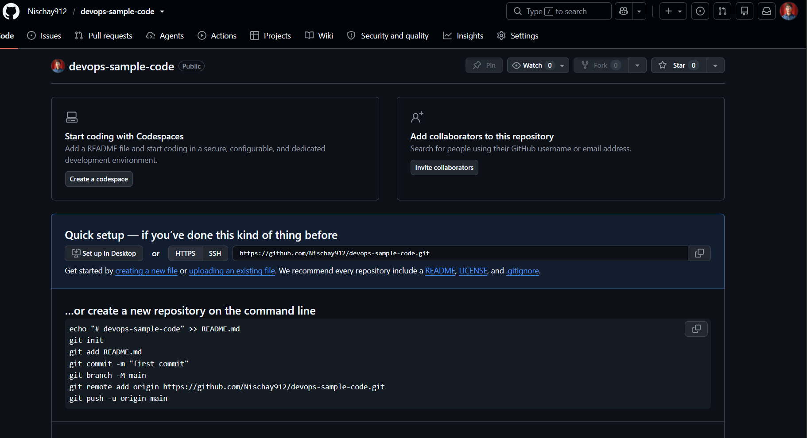

### Part 2: Local Script and Git Push
Writing the `hello-world.sh` script locally:
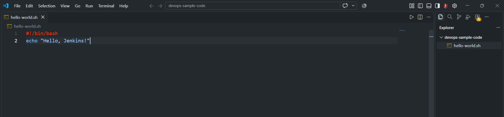

Initializing Git and committing the code:
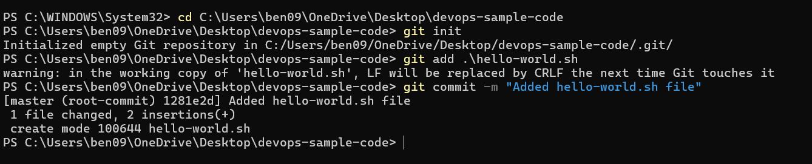

Pushing the code to the GitHub remote repository:
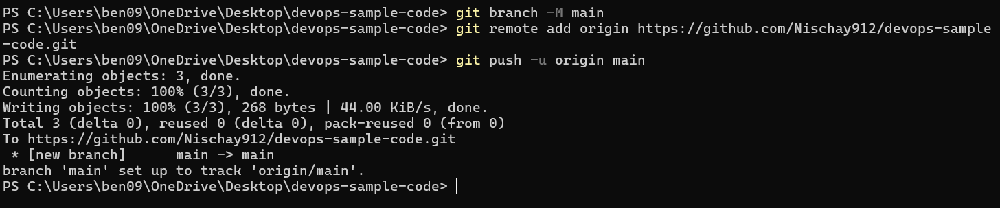

### Part 3: Jenkins Job Configuration
Starting the Jenkins Docker container:
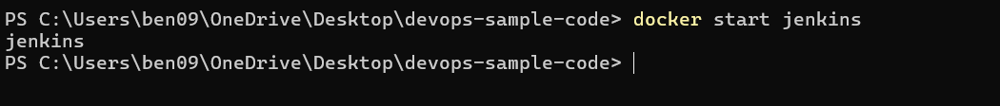

Logging back into Jenkins using the admin token:
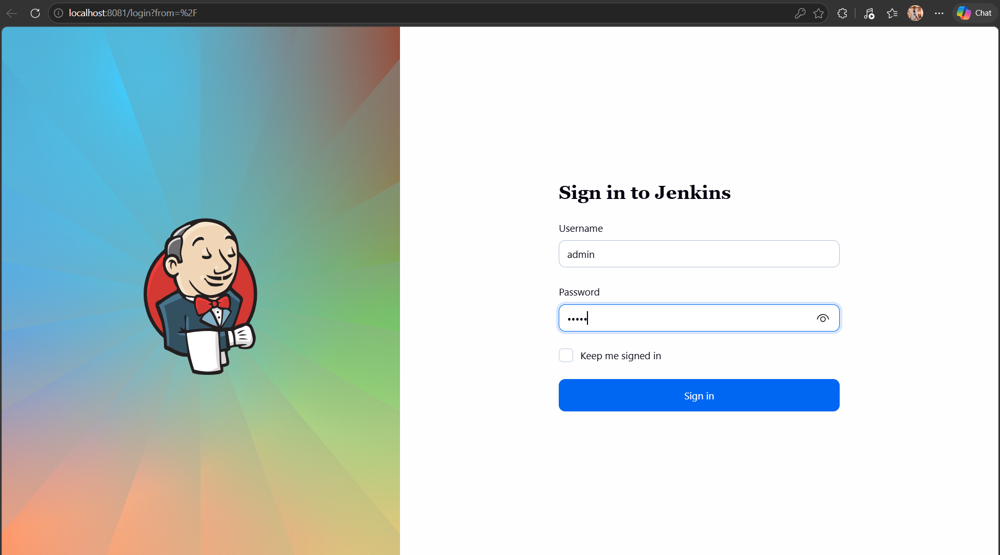

Creating a new Freestyle project named `HelloWorld`:
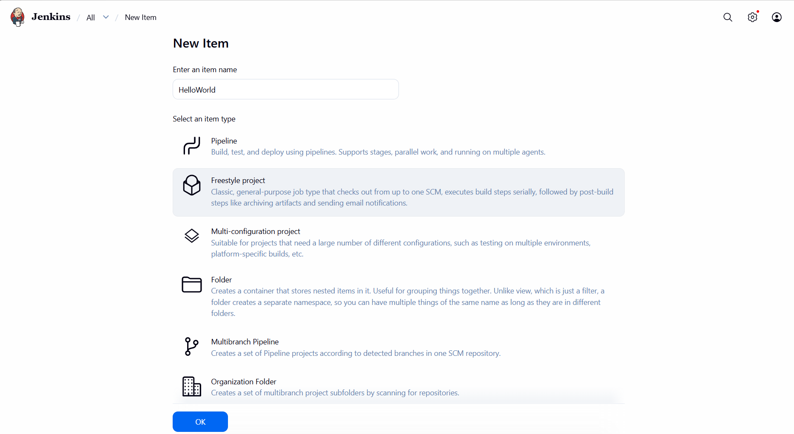

Adding the job description:
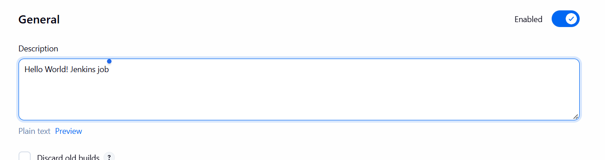

Configuring Source Code Management (Git URL and branch):
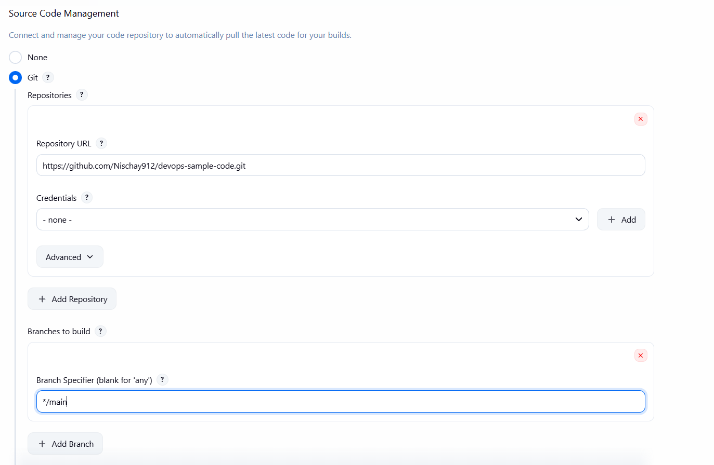

Adding the Execute Shell build step:
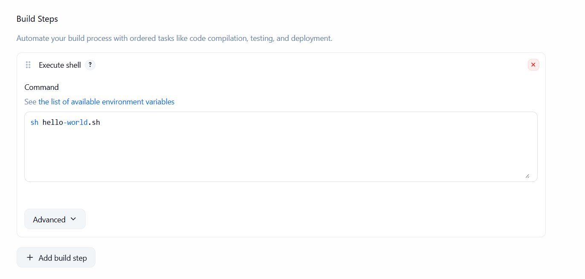

### Part 4: Running the Build
Triggering the build from the dashboard:
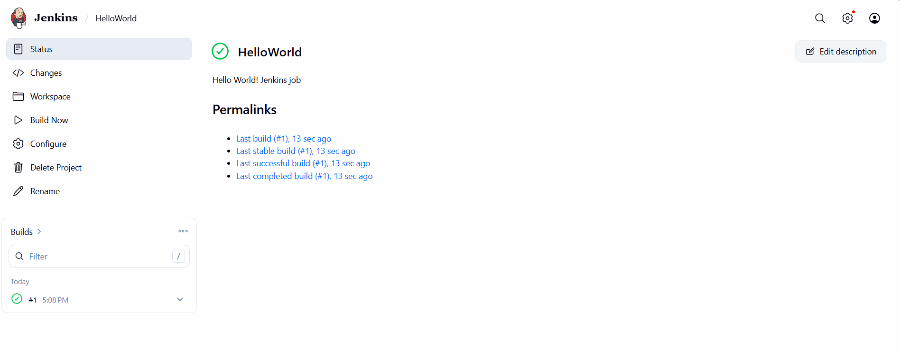

Successful Console Output showing the script execution:
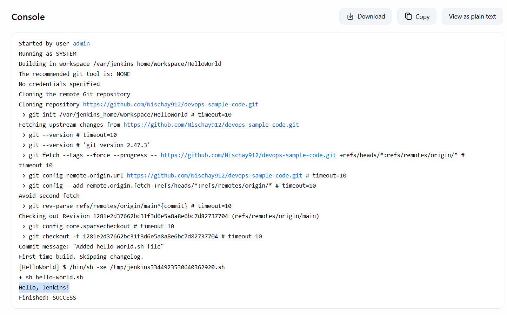
