# Exercise 9 – Jenkins Multi-Stage Pipeline: Deploying a Python Application

## Objective
Create and execute a multi-stage Jenkins CI/CD Pipeline (Build, Test, Deploy, Run Application, Test Application) for a Python Flask application, pull code from GitHub via SCM, troubleshoot missing runtime dependencies inside the Jenkins container, and verify automated execution.

## What I did
- Created a Python Flask web application (`app.py`), a dependencies list (`requirements.txt`), and automated unit tests using `unittest` (`test_app.py`).
- Authored a declarative `Jenkinsfile` defining stages: **Build**, **Test**, **Deploy**, **Run Application**, **Test Application**, and post-actions.
- Pushed the application code and Jenkinsfile to the `devops-sample-code` repository on GitHub.
- Created a new **Pipeline** job named `Python-MultiStage-Pipeline` on Jenkins.
- Configured Jenkins **Source Code Management (SCM)** pointing to the GitHub repository on the `main` branch.
- Ran the pipeline and identified the missing `python3` runtime error.
- Entered the Jenkins container as `root` via Docker CLI and installed `python3`, `python3-pip`, and `python3-flask`.
- Re-ran the pipeline to achieve all green stages and verified successful test pass and deployment in the console output.

## Key Concepts
- **Multi-Stage Pipeline** – Breaking the software delivery lifecycle into distinct, verifiable stages (Build, Test, Deploy, Run, Verify) within a single pipeline definition.
- **Declarative Pipeline (`Jenkinsfile`)** – A structured, human-readable format for defining CI/CD pipelines as code versioned directly inside the Git repository.
- **Docker-based Jenkins Environment** – Managing runtime tools and dependencies inside containerized Jenkins agents using `apt` and package managers.
- **Unit Testing in CI** – Automating unit test execution using Python's `unittest` framework to prevent broken code from proceeding to deployment.

## Output

### Part 1: GitHub Repository Setup
Pushed the Flask app, test suite, and Jenkinsfile to the `devops-sample-code` repository:
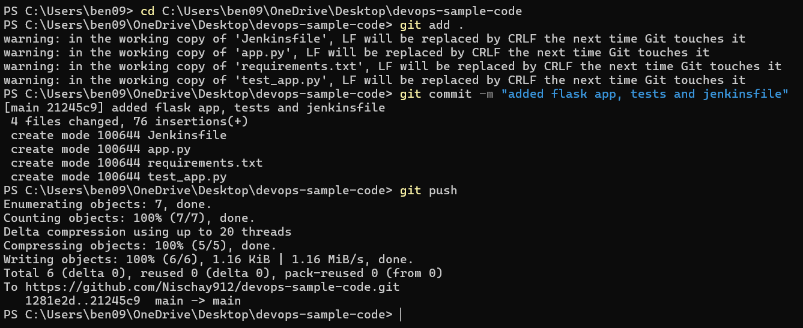

### Part 2: Starting Jenkins & Pipeline Job Setup
Started Jenkins container:
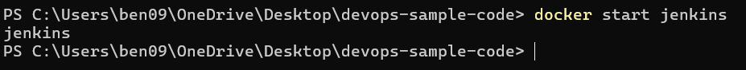

Retrieved admin password for authentication:
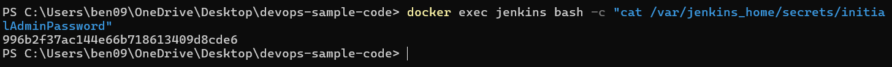

Created a new Pipeline project named `Python-MultiStage-Pipeline`:
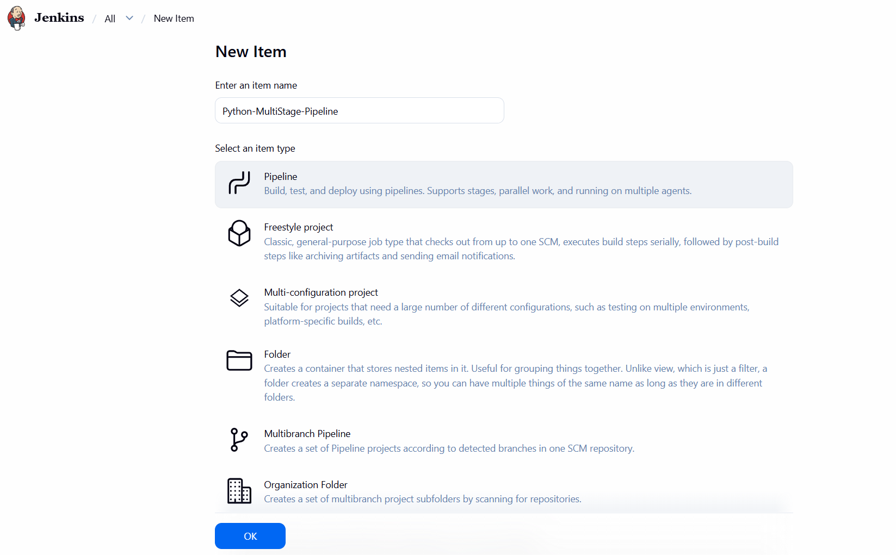

### Part 3: SCM Pipeline Configuration
Configured Git repository URL:
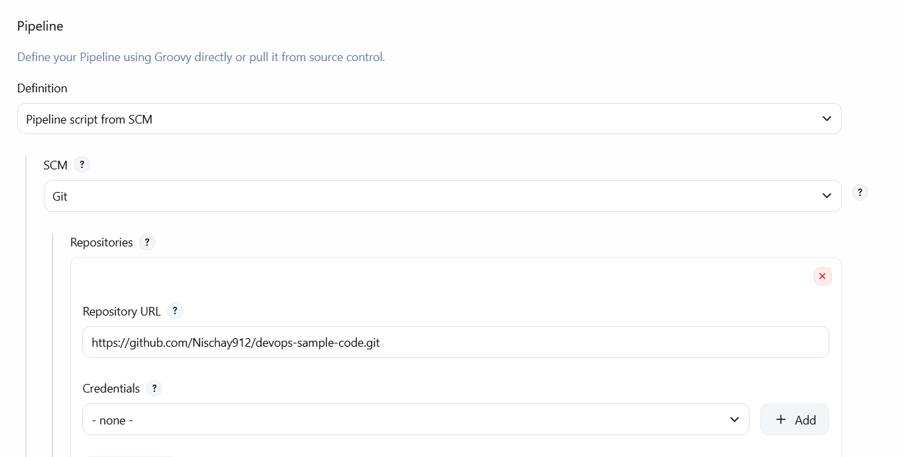

Set branch to `*/main`:
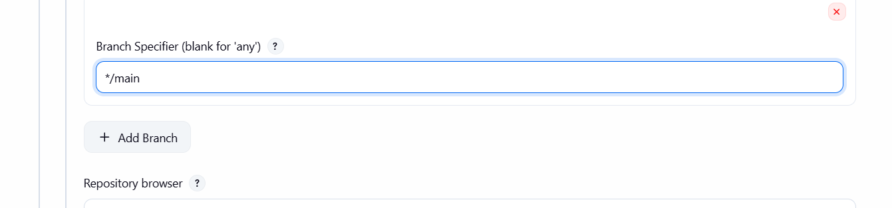

Confirmed Script Path is set to `Jenkinsfile`:
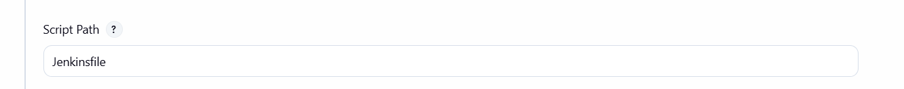

### Part 4: First Build Run & Error Handling
First build failed as expected due to missing Python runtime:
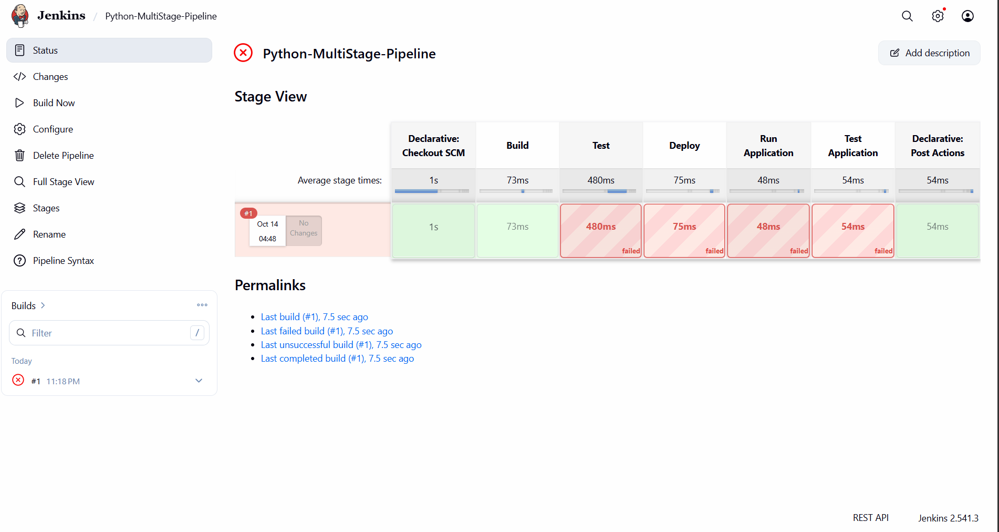

Console output showing `python3: command not found`:
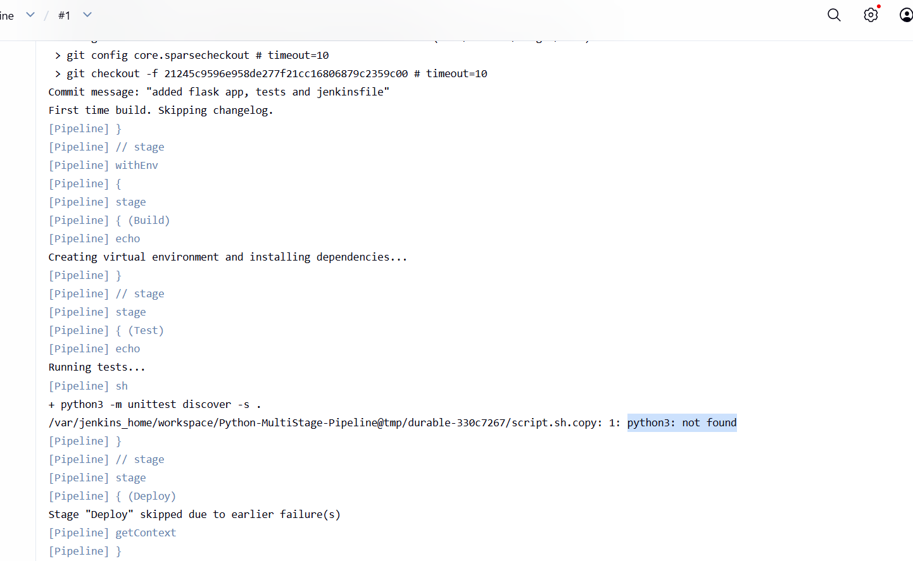

### Part 5: Resolving Dependencies Inside Jenkins Container
Accessed the Jenkins container as root via `docker exec`:
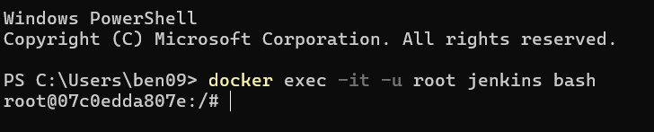

Ran `apt-get update`:
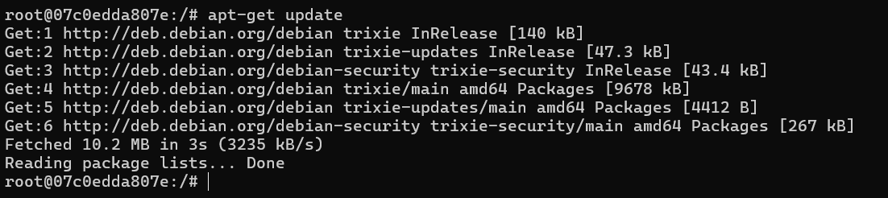

Installed `python3`, `python3-pip`, and `python3-flask`:
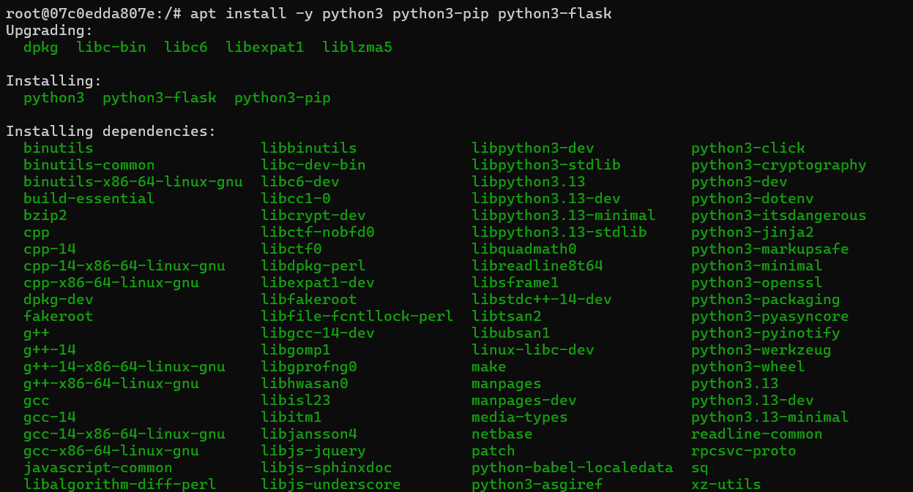

Exited container:
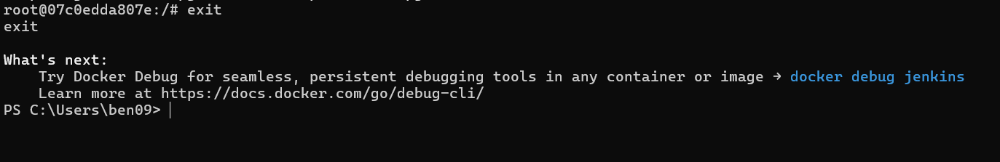

### Part 6: Successful Multi-Stage Pipeline Execution
Re-ran build showing all pipeline stages green:
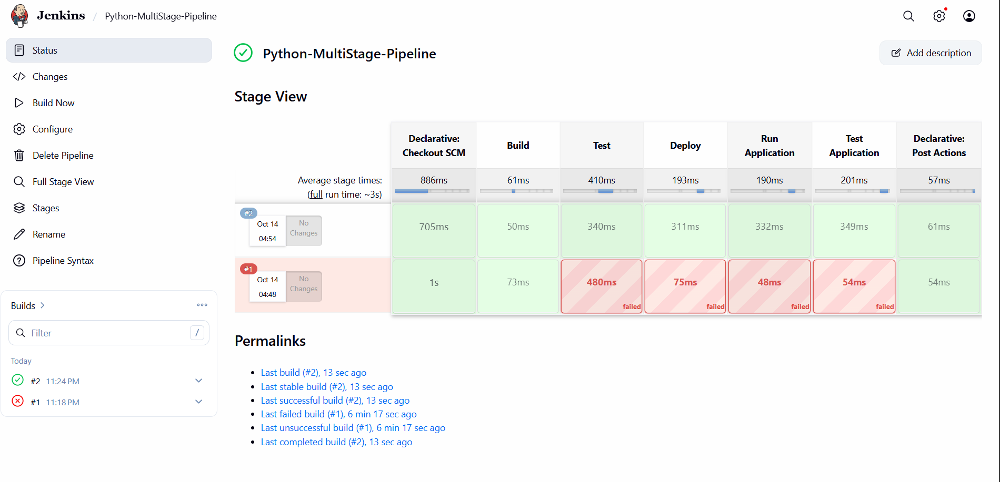

Console output confirming `Ran 1 test ... OK`, `Hello, Jenkins Multi-Stage Pipeline!`, and `Finished: SUCCESS`:
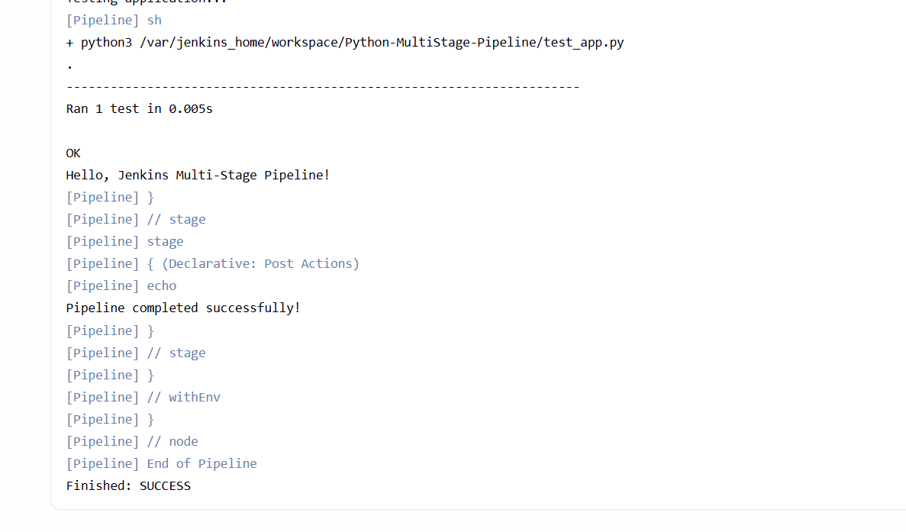
